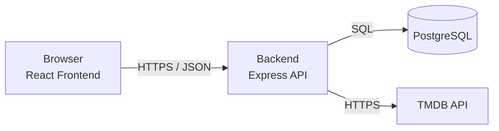
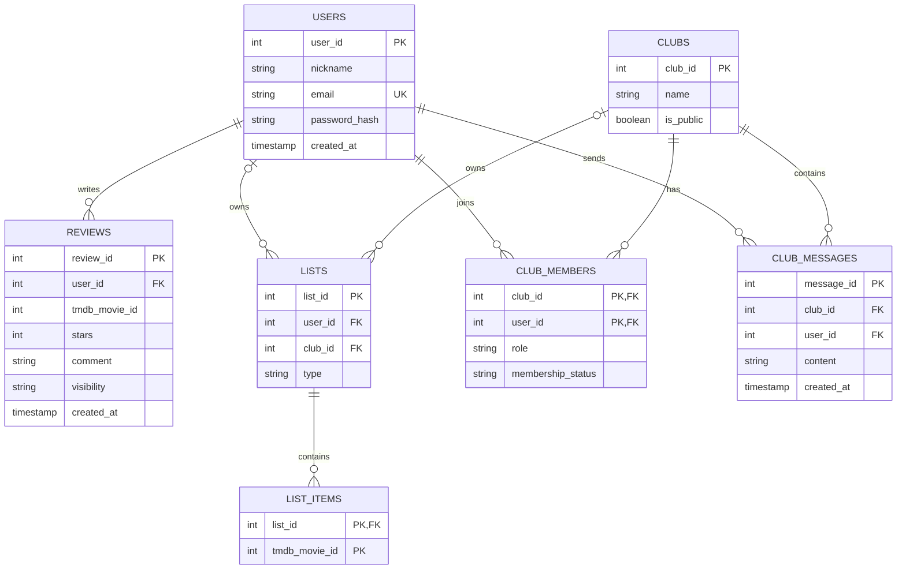

# Technical Specification – MovieBus

**Status:** Work in Progress

## 1. Overview

Movie Community is a web application designed for groups of friends and movie enthusiasts to discover movies, write reviews, share recommendations, and participate in movie clubs.

The application consists of three main components:

1. **Frontend** – A React-based web application accessed through a browser.
2. **Backend** – An Express.js REST API responsible for business logic, authentication, and authorization.
3. **Database** – A PostgreSQL database used to store users, clubs, reviews, and user-created movie lists.

Movie information is retrieved from the external **TMDB (The Movie Database) API**.

---

## 2. Technology Stack

| Component | Technology |
|------------|------------|
| Frontend | React + Vite |
| Backend | Node.js + Express |
| Database | PostgreSQL |
| Movie Data | TMDB API |
| Containerization | Docker Compose |
| Version Control | GitHub |
| Deployment | Azure |

---

## 3. Architecture

The client application communicates only with the backend API. The backend handles all business logic, database operations, and communication with external services.



---

## 4. Database

Movie data is not stored in the local database. Instead, the application stores the **TMDB movie ID**, and movie details are retrieved from the TMDB API when needed.



## 5. Development Environment

### Requirements

- Git
- Docker Desktop

### Setup

1. Install Git and Docker Desktop.
2. Copy `.env.example` and rename it to `.env`.
3. Start the application:

```bash
docker compose up --build
```

### Access URLs

Frontend:

```text
http://localhost:5173
```

Backend:

```text
http://localhost:3000
```

---

## 6. Future Additions

The following sections will be expanded during future sprints:

- API Documentation (Sprint 2)
- Authentication and Security Design
- Azure/Render Deployment Guide
- Testing Documentation
- CI/CD Pipeline Documentation
- Performance and Scalability Considerations
