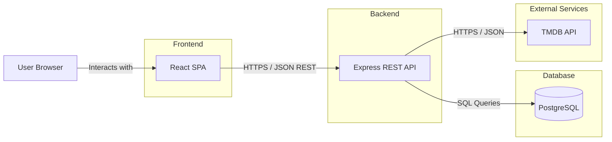

# System Architecture

The application uses a React frontend, an Express REST API backend, and a PostgreSQL database. Movie information is retrieved from the external TMDB API.

## Architecture Diagram

## Components

- **React:** User interface and client-side navigation.
- **Express:** REST API, authentication, and application logic.
- **PostgreSQL:** Stores users, reviews, movie lists, and clubs.
- **TMDB API:** Provides movie information.
