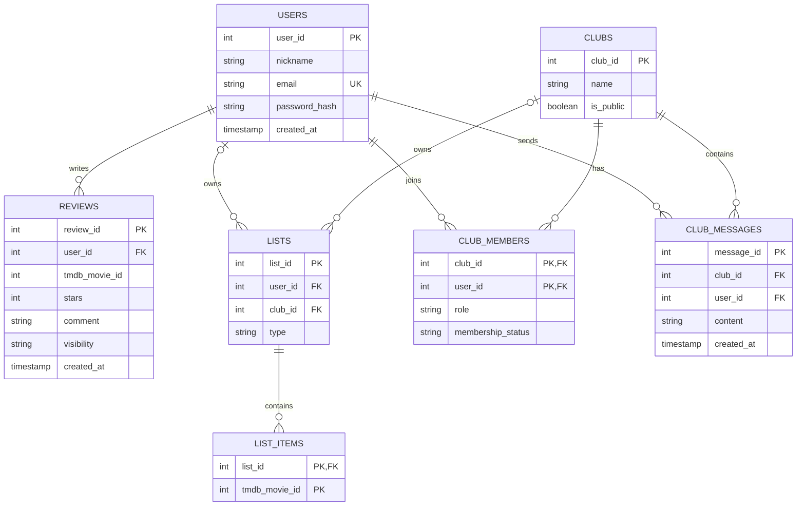

# Database Design

The application uses PostgreSQL to store user information, movie reviews, lists, clubs, memberships, and messages.

Movie details are retrieved from the TMDB API using movie IDs.

## Entity Relationship Diagram

## Database Notes

- Each review belongs to one user and references a TMDB movie.
- Reviews can be public or private.
- Movie lists can belong to either a user or a club.
- Each list belongs to exactly one owner: a user or a club.
- Club memberships store user roles and membership status.
- Club messages belong to a club and have an author.
- Movie information is retrieved from TMDB instead of being stored in a separate movies table.

## Constraints

- User emails must be unique.
- Review stars must be between 1 and 5.
- Review visibility must be either public or private.
- A list must have exactly one owner (`user_id` or `club_id`).
- Primary and foreign keys must be enforced in PostgreSQL.

## Status

Reviewed and approved by the team.
